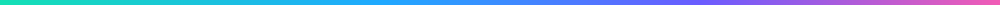

# Components

Each piece: what it is for, then working markup. Classes come from `components.css`; colours from `tokens.css`.


## ArrowButton

The small round control that opens a row: 28px, an even 2px rainbow ring, a drawn chevron.

- You provide an `aria-label` and the link or action.
- Put every arrow in one column on the same right edge. Rows with nothing to open keep the empty column.
- Draw the chevron as SVG. A typed › sits low and off-centre.
- In an email the whole button is one picture, so mail apps cannot shift the chevron.


```html
<div class="stage"><button class="sl-go" aria-label="Open"><svg viewBox="0 0 12 12" fill="none" stroke="currentColor" stroke-width="2" stroke-linecap="round" stroke-linejoin="round" aria-hidden="true"><path d="M4.5 2.5 8 6l-3.5 3.5"/></svg></button><button class="sl-go" aria-label="Open"><svg viewBox="0 0 12 12" fill="none" stroke="currentColor" stroke-width="2" stroke-linecap="round" stroke-linejoin="round" aria-hidden="true"><path d="M4.5 2.5 8 6l-3.5 3.5"/></svg></button><button class="sl-go" aria-label="Open"><svg viewBox="0 0 12 12" fill="none" stroke="currentColor" stroke-width="2" stroke-linecap="round" stroke-linejoin="round" aria-hidden="true"><path d="M4.5 2.5 8 6l-3.5 3.5"/></svg></button></div>
```


## Band

The dark band that opens and closes a letterhead: an email, a document, a summary page.

- Top band: logo top left, a quiet detail top right, a small rainbow label, then a two-line headline. Line 1 is bright, line 2 is grey.
- You provide the label, the two headline lines and the detail.
- The headline says what matters. No greeting.
- Bottom band: the logo again and one or two short grey lines.
- The band is dark in both themes. Everything between the bands is the plain page.
- On a band, all text is white or grey. Colour comes only from the rainbow label.


```html
<div style="padding:18px 22px;max-width:600px">
<div class="sl-band"><div class="top"><span class="name">Simple.</span><span>Tue, 17 Nov</span></div>
<div style="height:30px"></div><span class="sl-rbl">Morning Update</span><h2>3 things need you,<i>3 emails are ready to send.</i></h2></div>
<div style="padding:20px 30px;border-left:1px solid var(--line);border-right:1px solid var(--line)"><div class="sl-label">On today</div>
<p style="margin:8px 0 0;font:400 15px/1.55 var(--font-sans)">The page between the bands stays plain.</p></div>
<div class="sl-band foot"><div class="top"><span class="name" style="font-size:15px">Simple.</span><span>Keep it simple.</span></div></div>
</div>
```


## BrandName

How a brand signs off: the name or one word in rainbow lettering, closed by a gradient full stop.

- In running text, the name is bold in `tp-word` with its dot: `<span class="tp-name">Two Points<i class="tp-dot"></i></span>`. Not more than once a paragraph.
- A section heading has two tones: a plain statement in ink, then a quiet part (`.tp-quiet`) that ends in ONE rainbow word (`.tp-rb`) and the dot.
- The dot is a real circle (`tp-dot`, violet into pink), not a typed full stop, so it can drop in once when the headline lands.
- On the dark band use the bright line gradient (`.tp-rbl`).
- Simple signs off the same way in its own colours: "Simple." with a lime-to-violet dot.
- Email and PDF cannot draw gradient text: use a picture of the word, or per-letter colours.


```html
<div class="wrap">
<h2 class="tp-h2">Multiple trades. <span class="tp-quiet">One set of <em class="tp-rb">ropes</em><i class="tp-dot" aria-hidden="true"></i></span></h2>
<p>I founded <span class="tp-name">Two Points<i class="tp-dot" aria-hidden="true"></i></span> with the vision of building a team that does the job properly.</p>
<div class="band">Because ladders only go <em class="tp-rbl">so far</em>.</div>
</div>
```


## Button

The main action: a white (light) or charcoal (dark) button with a bold 1.5px rainbow edge and a faint glow from the bottom.

- You provide the label. One line, a verb, what happens next: "Send", "Approve & email client".
- `.sl-btn` is the phone pill, 44px tall. Add `.rect` on a desktop: 36px tall, 10px corners.
- Two buttons side by side: give the second `.mirror`.
- `.alert` is for a warning action only, such as reporting an incident.
- Do not fill a button with the rainbow. Do not let a label wrap.


```html
<div class="stage"><button class="sl-btn">+ New site report</button><button class="sl-btn mirror">+ New SSSP</button><button class="sl-btn alert">Incident</button></div>
<div class="stage" style="padding-top:0"><button class="sl-btn rect">Approve &amp; email client</button><button class="sl-btn rect mirror">Close job only</button></div>
```


## Card

A page-level card: white surface, a clear outline, 14px corners, a soft shadow.

- You provide a title, one figure or a short list, and a foot line that says what to do next.
- Add `.action` when work is waiting: the outline becomes the red edge with a faint red glow. Nothing else changes.
- A zero is grey (`.sl-fig.zero`). A count of things owed is red (`.sl-fig.owed`). Money stays ink, even at $0.
- Cards lift 2px on hover. Never an outer ring.
- No cards inside cards. In an email or document, use rows on the plain page.


```html
<div class="stage" style="align-items:stretch">
<div class="sl-card action" style="width:190px"><h3>Site reports</h3><div class="sl-fig owed" style="margin:10px 0 6px">7</div><p>Review and send</p></div>
<div class="sl-card" style="width:190px"><h3>Quotes</h3><div class="sl-fig" style="margin:10px 0 6px">$12,480</div><p>Waiting on clients</p></div>
<div class="sl-card" style="width:190px"><h3>To book</h3><div class="sl-fig zero" style="margin:10px 0 6px">0</div><p>Nothing to book</p></div>
</div>
```


## DotList

A soft panel of short items, each led by a small Alpenglow dot: the way to list kit, inclusions or what's on site.

- You provide a label, three to six items (a bold name and one detail line) and an optional footnote.
- Panel is `tp-soft` with `tp-radius-photo` corners. No border, no shadow.
- The dot is the only colour. Items are facts, not features: name the real thing ("Petzl I'D EVAC"), not a claim.


```html
<div class="wrap"><div class="tp-kit">
<span class="tp-eyebrow">In the rescue kit</span>
<ul>
<li><b>Petzl Rescucender</b><span>Rope clamp for hauling systems.</span></li>
<li><b>Petzl JAG system</b><span>Pre-rigged haul kit, ready to go.</span></li>
<li><b>Petzl I'D EVAC</b><span>Descender set up for rescue.</span></li>
</ul>
<p>Kept for rescue only. Never used for access or work positioning.</p>
</div></div>
```


## EmailSignature

The Two Points email signature: a 418px card built from tables, inline styles and hosted pictures, so it survives Gmail, Outlook and Apple Mail.

- Rows, top to bottom: a dark header (`band`) with the white wordmark and four ringed social icons; the 3px Alpenglow rule (a picture); the app icon, name, role and qualification beside the SiteWise badge; a hairline; phone, email and website, each with a 16px ringed icon.
- You provide the person's name, role, qualification, phone and email. Everything else stays.
- Keep the FIXED width (416px inside). Gmail's signature editor strips `width:100%` and `max-width` on inner tables: a stretched version broke apart on the phone.
- Every picture is a PNG at 2x, hosted on the brand's website. Never move or rename a picture once a signature uses it; older signatures still point at it.
- Text is Helvetica/Arial. Gradient text, web fonts and CSS backgrounds do not survive mail apps.
- The Gmail iPhone app's own mobile signature is plain text only: turn Mobile signature off so the full one is used.
- Note: in the live signature the third line is ink-3 (#8b9199), which is below 4.5:1 at 11.5px. This preview uses ink-2.


```html
<div class="mail"><p>Cheers,</p><table cellpadding="0" cellspacing="0" border="0" role="presentation" style="border-collapse:separate;font-family:Helvetica,Arial,sans-serif;color:#15171a;"><tr><td bgcolor="#ffffff" style="padding:0;background-color:#ffffff;border:1px solid #e2e5e8;border-radius:10px;"><table cellpadding="0" cellspacing="0" border="0" role="presentation" width="416" style="border-collapse:collapse;width:416px;"><tr><td bgcolor="#14170f" style="padding:9px 16px;background-color:#14170f;border-radius:9px 9px 0 0;"><table cellpadding="0" cellspacing="0" border="0" role="presentation" width="100%"><tr><td valign="middle"></td><td valign="middle" align="right"><table cellpadding="0" cellspacing="0" border="0" role="presentation" align="right"><tr><td valign="middle" style="padding:0;"></td><td style="width:7px;font-size:0;">&nbsp;</td><td valign="middle" style="padding:0;"></td><td style="width:7px;font-size:0;">&nbsp;</td><td valign="middle" style="padding:0;"></td><td style="width:7px;font-size:0;">&nbsp;</td><td valign="middle" style="padding:0;"></td></tr></table></td></tr></table></td></tr><tr><td style="padding:0;font-size:0;line-height:0;"></td></tr><tr><td style="padding:12px 16px 0;"><table cellpadding="0" cellspacing="0" border="0" role="presentation" width="100%"><tr><td valign="middle" width="48" style="padding:2px 0 0;width:48px;"></td><td valign="middle" style="padding:0 0 0 12px;"><div style="font-family:Helvetica,Arial,sans-serif;font-size:18px;line-height:22px;font-weight:bold;letter-spacing:-0.3px;color:#15171a;">Joe Pope</div><div style="font-family:Helvetica,Arial,sans-serif;font-size:12.5px;line-height:17px;color:#555b63;">Managing Director</div><div style="font-family:Helvetica,Arial,sans-serif;font-size:11.5px;line-height:15px;color:#555b63;">IRATA Level 3 Supervisor</div></td><td valign="middle" align="right" width="144" style="padding:2px 0 0;width:144px;"></td></tr></table></td></tr><tr><td style="padding:11px 16px 0;"><div style="border-top:1px solid #e9ebe6;height:1px;font-size:0;">&nbsp;</div></td></tr><tr><td style="padding:9px 16px 10px;"><table cellpadding="0" cellspacing="0" border="0" role="presentation" width="100%"><tr><td valign="middle" align="left"><table cellpadding="0" cellspacing="0" border="0" role="presentation"><tr><td valign="middle" style="padding:0 5px 0 0;"><a href="#" style="text-decoration:none;"></a></td><td style="font-family:Helvetica,Arial,sans-serif;font-size:11.5px;line-height:16px;font-weight:bold;white-space:nowrap;">021 0898 7180</td></tr></table></td><td valign="middle" align="center"><table cellpadding="0" cellspacing="0" border="0" role="presentation" align="center"><tr><td valign="middle" style="padding:0 5px 0 0;"><a href="#" style="text-decoration:none;"></a></td><td style="font-family:Helvetica,Arial,sans-serif;font-size:11.5px;line-height:16px;font-weight:bold;white-space:nowrap;">Joe@twopoints.co.nz</td></tr></table></td><td valign="middle" align="right"><table cellpadding="0" cellspacing="0" border="0" role="presentation" align="right"><tr><td valign="middle" style="padding:0 5px 0 0;"><a href="#" style="text-decoration:none;"></a></td><td style="font-family:Helvetica,Arial,sans-serif;font-size:11.5px;line-height:16px;font-weight:bold;white-space:nowrap;">twopoints.co.nz</td></tr></table></td></tr></table></td></tr></table></td></tr></table></div>
```


## GlowPanel

The one dark panel on a light page: `band` with two soft glows breathing slowly in a brand's colours, one bottom-left, one top-right.

- Default glows are Simple's (lime into mint, sky into violet). Add `.alpenglow` for Two Points' own colours.
- You provide the panel content: a logo line, a two-tone heading, a short paragraph, a list split by `band-line` hairlines and one `.tp-btn.dark`.
- One per page. Each glow drifts on its own clock (16s and 19s), so they never move in step. Everything stops under reduced motion.
- This is how Two Points shows Simple: a panel in Simple's colours inside the Two Points page.


```html
<div class="wrap"><div class="tp-glow">
<div class="logo">Simple</div>
<h3>Outstanding paperwork. <span>Kept simple.</span></h3>
<p>Our own job software: site reports, safety plans and job tracking, sent the same day.</p>
<a class="tp-btn dark" href="#">See Simple <svg viewBox="0 0 16 16" aria-hidden="true"><path d="M5 11 11 5M6 5h5v5"/></svg></a>
</div></div>
```


## Highlighter

A soft Alpenglow marker (`tp-marker`) that sweeps in behind a few key values, one after another.

- Use it on a short row of facts, such as the trust row under the hero: "IRATA Level 3", "SiteWise Gold".
- You provide the words inside `<mark class="tp-mk">`. Add `.sweep` to play the sweep once as it scrolls into view; stagger siblings about 200ms.
- Three or four values at most on a page. It marks the proof, not decoration.
- The words stay ink. The marker sits behind them and wraps with the text.


```html
<dl>
<div><dt>Led by</dt><dd><mark class="tp-mk sweep">IRATA Level 3</mark></dd></div>
<div><dt>Safety</dt><dd><mark class="tp-mk sweep" style="animation-delay:.2s">SiteWise Gold</mark></dd></div>
<div><dt>Quotes</dt><dd><mark class="tp-mk sweep" style="animation-delay:.4s">Free, on site</mark></dd></div>
</dl>
```


## PhotoReveal

How a job photo arrives: a grey cover with a soft sheen while it loads, then the cover is drawn down and away, led by a thin Alpenglow edge.

- You provide a real job photo (never AI imagery for real work) inside `.tp-ph`, with alt text.
- Script adds `.wait` to each photo, then `.loaded` about 180ms after the photo is BOTH loaded and 30% in view. Tie it to scrolling into view, not to the download, or it plays off screen.
- Never hide the `` itself (no `display:none`, no `clip-path`): browsers skip loading hidden lazy images.
- Corners are `tp-radius-photo`. Under reduced motion the photo just appears.


```html
<div class="grid">
<div class="tp-ph wait"></div>
<div class="tp-ph wait"></div>
</div>
<script>
var phs = document.querySelectorAll('.tp-ph');
function play() { phs.forEach(function (p, i) { p.classList.remove('loaded'); void p.offsetWidth; setTimeout(function () { p.classList.add('loaded'); }, 900 + i * 220); }); }
phs.forEach(function (p) { p.addEventListener('click', play); });
play();
</script>
```


## RingButton

The Two Points button: a 48px pill with a 1.5px Alpenglow ring (`tp-ring`) round a solid fill.

- You provide the label: a short verb phrase that says what happens ("Get a free quote", "See Simple").
- `.tp-btn.ink`: the main action on a white page. `.tp-btn.paper`: the second action beside it. `.tp-btn.dark`: on the dark band or a dark panel.
- `.small` is 38px tall, for tight spots such as a card footer.
- An outward link gets a small diagonal arrow, drawn as SVG, that nudges up and right on hover.
- The ring is the only colour. Never fill a button with the rainbow. One line, never wrapping.
- Simple's own button is the glow button (`Button`); use this one for Two Points.


```html
<div class="stage"><button class="tp-btn ink">Get a free quote</button><button class="tp-btn paper">See our work</button><button class="tp-btn paper small">View certificate</button></div>
<div class="band"><a class="tp-btn dark" href="#">See Simple <svg viewBox="0 0 16 16" aria-hidden="true"><path d="M5 11 11 5M6 5h5v5"/></svg></a><button class="tp-btn dark small">Call 021 0898 7180</button></div>
```


## Row

One line of a list: a bold title, a grey detail under it, then a tag and an arrow on the right.

- You provide the title, the detail line, the tag and where the arrow goes.
- Title, tag and arrow share one centre line. All arrows share one right edge.
- A hairline sits under each row. No box round a row.
- A section of rows opens with a `.sl-label`; its count sits right beside the label.
- The title says the task: "Send 7 site reports".


```html
<div style="padding:22px 26px;max-width:560px">
<div class="sl-label">Your to-do <span class="sl-count">2</span></div>
<div class="sl-row"><div><b>Send 7 site reports</b><span class="d">St Andrew's College, sent from site 6 Nov</span></div><span class="sl-tag waiting">Waiting</span><button class="sl-go" aria-label="Open site reports"><svg viewBox="0 0 12 12" fill="none" stroke="currentColor" stroke-width="2" stroke-linecap="round" stroke-linejoin="round" aria-hidden="true"><path d="M4.5 2.5 8 6l-3.5 3.5"/></svg></button></div>
<div class="sl-row"><div><b>Renew 4 certificates</b><span class="d">Two expire this week</span></div><span class="sl-tag waiting">Overdue</span><button class="sl-go" aria-label="Open crew"><svg viewBox="0 0 12 12" fill="none" stroke="currentColor" stroke-width="2" stroke-linecap="round" stroke-linejoin="round" aria-hidden="true"><path d="M4.5 2.5 8 6l-3.5 3.5"/></svg></button></div>
<div class="sl-row"><div><b>Book jobs</b><span class="d">Every accepted quote has a date</span></div><span class="sl-tag clear">Clear</span><button class="sl-go" aria-label="Open jobs to book"><svg viewBox="0 0 12 12" fill="none" stroke="currentColor" stroke-width="2" stroke-linecap="round" stroke-linejoin="round" aria-hidden="true"><path d="M4.5 2.5 8 6l-3.5 3.5"/></svg></button></div>
</div>
```


## StatusTag

A soft tint with dark text that says the state of a row in one or two words.

- `.waiting` (soft red): something is owed, overdue, or ready for a decision.
- `.clear` (soft lime): nothing needed, done, money in.
- Plain: neutral facts such as "Draft".
- Always a word. Never colour alone. One line, never wrapping.
- Right-align tags to one spot just left of the arrow column.


```html
<div class="stage"><span class="sl-tag waiting">Waiting</span><span class="sl-tag waiting">Overdue</span><span class="sl-tag waiting">3 ready</span><span class="sl-tag clear">Clear</span><span class="sl-tag">Draft</span></div>
```


## Tile

The small marks that carry the rainbow: a numbered step tile, a calendar block and one bar.

- `.sl-tile`: a dark squircle with a thin rainbow edge and the number in rainbow. Use it only for a real sequence.
- `.sl-cal`: a dark date block with a 3px rainbow top edge, big day number, small month.
- `.sl-bar`: one rainbow bar on a soft track. One per page.
- You provide the number, the date, or the bar's width.
- These are the only places a rainbow fill appears. Keep them small.


```html
<div class="stage"><span class="sl-tile"><b>1</b></span><span class="sl-tile"><b>2</b></span><span class="sl-tile"><b>3</b></span>
<span class="sl-cal" style="margin-left:18px"><b>17</b><span>Nov</span></span>
<div style="flex:1;min-width:160px;margin-left:18px"><div class="sl-bar"><i style="width:62%"></i></div></div></div>
```
